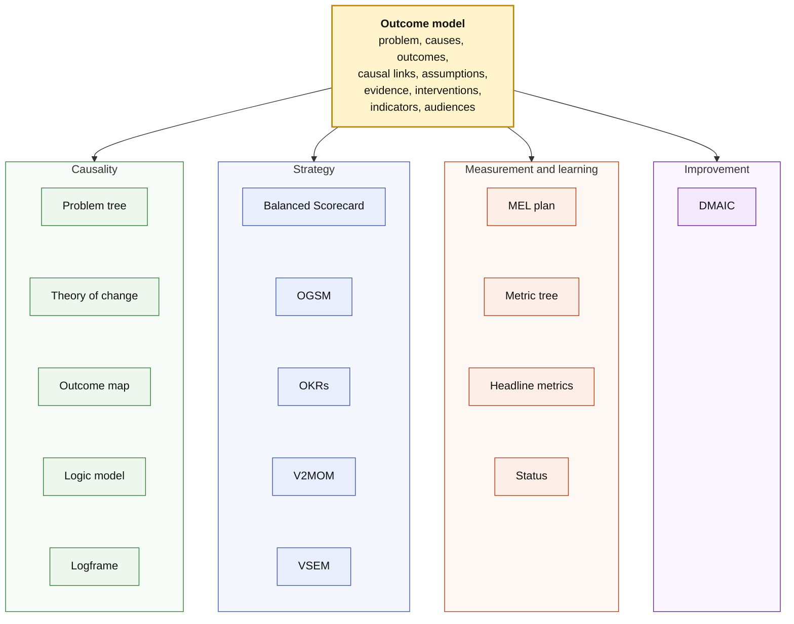
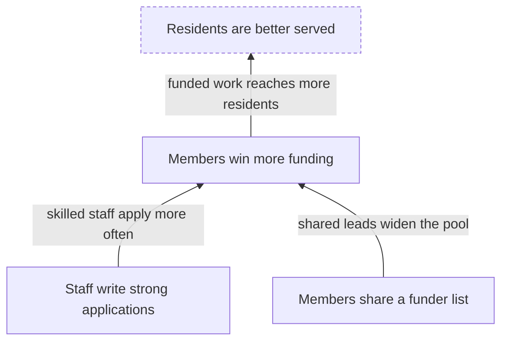
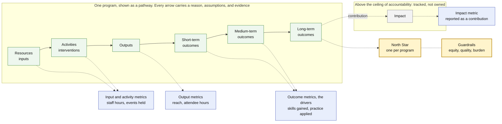
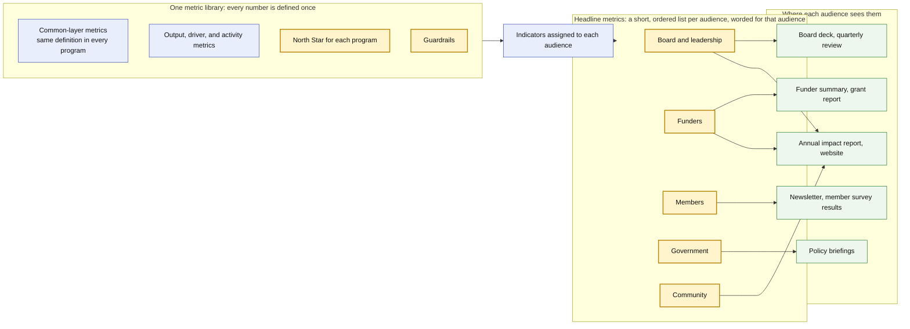

# Outcome Model

**Outcome Model** is an AI-native format from
[ProductBuildersHQ](https://github.com/ProductBuildersHQ) for describing the
outcomes a product, program, or organization works toward, and everything needed
to plan for them, reach them, and show whether it did. It serves companies and
nonprofits alike. One document holds four views of the same work:

- **Causality:** why what you do should lead to the change you want. The
  outcomes, the causal links between them with a reason for each, and the
  assumptions and evidence behind them. This view makes the document a
  [causal model](https://en.wikipedia.org/wiki/Causal_model).
- **Strategy:** what you commit to. The objective, the strategies that reach it
  and who owns each, and the measures and targets that say it has been reached.
- **Measurement and learning:** how you will know. Indicators, observations, and
  status over time, the evaluations planned, and the questions you most need
  answered.
- **Improvement:** how you make a measured process better and keep the gain.
  Baselines and targets, root causes, and control limits.

It is a Go-first data model with generated JSON Schema, plus an SDK, the
`outcome-model` CLI, and an MCP server.

You describe the work once, in one outcome model. The problem tree, the
[theory of change](https://en.wikipedia.org/wiki/Theory_of_change), the logic
model, and the logframe; strategy formats such as OKRs, V2MOM, VSEM, OGSM, and
the Balanced Scorecard; a monitoring, evaluation, and learning (MEL) plan; and
improvement formats such as DMAIC are all **projections** of it. Each draws the
same model for a different reader and leaves something out, and none of them is
a part of another.

Within each view, formats that are steps of one process are listed in the order
you would use them. The strategy formats are alternatives to one another, so
they are listed alphabetically.



## What is an outcome model?

An outcome model is one structured description of **the outcomes you are
working toward**: how and why change is expected to happen, what you commit to,
how you will measure it, and how you will improve it. It holds:

- the **problem** it responds to, the **causes** that produce it, and the
  **effects** it leads to;
- the **outcomes** that should change, at five levels from output to impact, and
  the **causal links** between them, each with a reason to believe it;
- the **assumptions** that must hold for a link to work, and the **evidence** for
  and against them;
- what is done to bring the change about: **interventions**, and the resources
  and outputs they need and produce;
- how progress is **measured**: indicators, targets, and observations over time;
- who is accountable for each change, and who needs to see what.

Every element records where it came from (stated, inferred, a hypothesis, or
confirmed), so a reader can tell what an organization has claimed from what an
assistant has proposed.

The model is a graph of causes and measures. A diagram or a table of it is a
projection, and one model can produce many.

## Projections

Each projection answers a different question for a different reader. They are grouped here by the view they mainly draw on.

### Causality

Why should what we do lead to the change we want?

| Projection | Answers | Get it with |
|------------|---------|-------------|
| **Problem tree** | What is the problem, what causes it, and what does it lead to? The core problem in the middle, causes (roots) below and effects (branches) above, with the outcomes that address each. See [the guide](guides/problem-tree.md) | `report problem-tree` (`--pathway` for one program's tree), `problem-tree-d2`, `problem-tree-json` |
| **Theory of change** | Why should what we do lead to the change we want, and in what order must outcomes happen? Drawn as pathways of change, from the earliest outcome at the bottom to the long-term goal at the top | `report pathway` |
| **Outcome map** | What changes, who is responsible for each change, and how is it measured? The outcomes by level, each with its sphere, owner, cause, and indicators | `report outcome-map` |
| **Logic model** | What goes in, what is done, and what comes out? Stages from inputs, activities, and outputs through short-, medium-, and long-term outcomes to impact, one per pathway | `report logic-model`, `logic-model-d2` |
| **Logframe** | What do we promise, and how will we verify it? Narrative, indicators with targets, means of verification, and assumptions, for contracts and monitoring | `report logframe` |

### Strategy

What do we commit to, and who owns it?

| Projection | Answers | Get it with |
|------------|---------|-------------|
| **Balanced Scorecard** | Is the strategy balanced across what funders, customers, processes, and capabilities need, and how does each objective drive the next? Outcomes placed in scorecard perspectives as objectives, the strategy map from the causal links between them, pathways as strategic themes, indicators as lead and lag measures, and interventions as initiatives. See [the mapping](guides/bsc.md) | `export bsc` |
| **OGSM** | What one thing do we want to achieve, how will we know, what choices get us there, and are they working? The objective from the context, due at the end of the time horizon, its outcomes' indicators as goals, one strategy per pathway serving the goals its outcomes lead to, each pathway's North Star and guardrails as measures, and its interventions as actions. See [the mapping](guides/ogsm.md) | `export ogsm` |
| **OKRs and outcome journeys** | What will a team commit to this quarter, and how does a person move through the outcomes? For the [PRISM](#part-of-the-prism-ecosystem) planning tools | `export okr`, `export journey` |
| **V2MOM** | What do we want, what matters, how will we get it, what is in the way, and how will we know? Vision and values from the context, one method per pathway with its interventions as projects, measures from each pathway's North Star and guardrails, and obstacles from risks and open assumptions. See [the mapping](guides/v2mom.md) | `export v2mom` |
| **VSEM** | Where are we going, how, with what work, and how will we know? Vision and mission from the context, one strategy per pathway with the resources it commits, its interventions as execution with owners and dates, metrics from each pathway's North Star and guardrails, and the impact outcomes' indicators as the vision's metrics. See [the mapping](guides/vsem.md) | `export vsem` |

### Measurement and learning

How will we know, and what must we learn?

| Projection | Answers | Get it with |
|------------|---------|-------------|
| **MEL plan** | How will we know it is working, when will we ask why, and what do we most need to learn? The outcomes as a results framework, interventions as activities, an indicator reference sheet per indicator, assumptions to monitor, and the evaluation plan, learning agenda, review meetings, and reporting schedule. See [the mapping](guides/mel.md) | `export mel` |
| **Metric tree and headline metrics** | What does each program steer by, and what is each audience told? | `report metric-tree`, `report headline` |
| **Status** | How far has it come? Each indicator's progress against its targets by a date, each outcome's and pathway's state, links and assumptions, and a confidence score for each route to impact, all from observations. See [the guide](guides/measurement.md) | `status`, `report exec`, `deck exec` |

### Improvement

How do we make a measured process better and keep the gain?

| Projection | Answers | Get it with |
|------------|---------|-------------|
| **DMAIC** | Which metrics are we improving, from what baseline to what target, what causes the gap, and is the gain holding? One category per pathway marked `projections: [dmaic]`, its numeric indicators as metrics with observations as data points, control limits once there are enough, root causes from the problem tree, and interventions as improvement initiatives. Lint first checks that those pathways are measured often enough. See [the mapping](guides/dmaic.md) | `export dmaic`, and `report dmaic-plan` to plan it before there is data |

Each projection leaves something out. A problem tree shows the problem, what
causes it, and what it leads to, but not the steps by which a program changes
it. A logic model shows the sequence from what
goes in to what comes out, and rarely why each step holds. A theory of change
shows why, and says less about what is delivered. A logframe fits the model into
a matrix for contracts, and OKRs keep only what a team commits to for a period.
None is derived from another. The outcome model holds what they all need, so any
of them can be drawn from it. A logic model that arrives on its own can seed a
*candidate* outcome model, but it cannot supply the reasons and assumptions it
never held, so those stay marked as inferred until someone confirms them.

```bash
outcome-model report problem-tree outcome-model.yaml      # the problem tree: causes, core problem, effects
outcome-model report pathway outcome-model.yaml           # the theory of change, as pathways of change
outcome-model report outcome-map outcome-model.yaml       # the outcome map
outcome-model report logic-model outcome-model.yaml       # a logic model for each pathway
outcome-model report logframe outcome-model.yaml          # the logframe matrix
outcome-model report definitions outcome-model.yaml       # all of them, plus metrics and glossary
outcome-model export okr outcome-model.yaml               # OKRs for the PRISM tools
outcome-model export journey outcome-model.yaml           # outcome journeys for the PRISM tools
outcome-model export v2mom outcome-model.yaml             # a V2MOM
outcome-model export vsem outcome-model.yaml              # a VSEM
outcome-model export ogsm outcome-model.yaml              # an OGSM
outcome-model export bsc outcome-model.yaml               # a Balanced Scorecard
outcome-model export dmaic outcome-model.yaml             # DMAIC improvement efforts
outcome-model export mel outcome-model.yaml               # a monitoring, evaluation, and learning plan
```

Change the model once and every projection changes with it, so the numbers and
labels never drift apart. (The outcome map here is the outcomes framework from the
ActKnowledge method; it is not IDRC's *Outcome Mapping*, which tracks progress
markers for the partners a program influences.)

## The theory of change

The theory of change is the projection many teams start from. It explains
**how and why the work is expected to bring about a change**, whether the work is
a product, a strategy, or a program. It starts from the long-term goal and works
backwards: what conditions must exist for the goal to be reached, what must
exist before each of those, and so on down to what is done today. Each step is an
**outcome**; each arrow between outcomes is a **causal link** with a reason for
believing it holds; and each belief that has to be true for a link to work is an
**assumption** that can be tested.



An illustration only. The dashed outcome sits above the organization's **ceiling
of accountability**: the program tracks it and contributes to it, but does not
claim it.

### Why it matters

The method grew up among foundations, development agencies, and funders, but it
is a tool for any goal: a product's adoption, a company's strategy, or a
program's impact. The sources agree on five reasons:

- **Planning.** Agree on what has to change, and in what order, before spending
  money on activities.
- **Closing the "missing middle".** Show how day-to-day activities connect to a
  long-term goal, instead of asserting that they do.
- **Evaluability.** Indicators and tests come from the causal reasoning, so you
  know what to measure and what would count as being wrong.
- **Communication.** Leaders, funders, partners, staff, and the people the work
  serves can see the same reasoning and argue with it.
- **Learning.** The model is a living framework. When evidence arrives, you revise
  it instead of defending it.

## How the chain, the metrics, and what each audience sees fit together

An outcome model is the chain from resources to impact. Metrics hang off each step
of it, and different readers should see a different few. The first diagram is one
program, shown as a pathway. The second shows how its metrics reach each audience.



Reading the first diagram:

- **Resource and activity metrics** show what went in and what was done.
  **Output metrics** show reach. **Outcome metrics** are the drivers: they
  say whether the change the program is for is happening.
- **A North Star** is the one number that best captures the value a program delivers
  to the people it serves. It sits on the highest outcome the program answers for, at
  or below the ceiling of accountability, and it is an outcome, never a count of
  outputs. Each program can have its own, because programs deliver different value.
  **Guardrails** keep it honest by watching what it could hurt, such as equity,
  quality, or staff burden.
- **Impact** sits above the ceiling. It is tracked and contributed to, not claimed.



Reading the second diagram:

- **Every number is defined once**, in one metric library. Two audiences that see the
  same figure see the same figure, with the same caveats and the same marker for
  whether it is attributable to the work or a contribution.
- **Headline metrics are what you tell people. The North Star is what you steer by.**
  They can differ. The board, funders, members, government, and the community each
  get a short list, worded for them, drawn from the same indicators. A North Star may
  lead one list and not appear in another.
- **Every box is something you can record and report today.** Mark an indicator as a
  program's North Star, with its guardrails, in the pathway's `focus`. Give each
  audience an ordered, worded `headline` list. `outcome-model report metric-tree`
  shows a program's North Star and every indicator from activity to impact, and
  `outcome-model report headline` shows what each audience is told. The amber boxes
  are the choices you make: which number a program steers by, and which few each
  audience leads with. `outcome-model lint` checks them.

## What this project gives you

| Benefit | How |
|---------|-----|
| **A model you can trust** | Every element records whether a source *stated* it, you *inferred* it, it is still a *hypothesis*, or reviewers *confirmed* it. Reports show how much of the model is established and how much is our reading |
| **Edits that cannot make it worse** | One validated, atomic patch engine behind the CLI, the SDK, and the AI tools. A change that adds structural errors is rejected, and `--dry-run` shows the result first |
| **Quality you can check** | A schema, structural validation, 81 deterministic lint rules, and a rubric for human or AI judges, so "is this a good outcome model?" has an answer you can repeat |
| **Progress you can measure** | Load a spreadsheet of numbers and see which indicators, outcomes, and pathways are on track, with assumptions that can cap a result and a confidence score for each route to impact |
| **Artifacts for each audience** | Executive and funder reports, audience stories, slide decks, Word and PowerPoint files, CSV tables, and OKR, V2MOM, VSEM, OGSM, Balanced Scorecard, DMAIC, and MEL exports, all from one source and stamped with the version and hash |
| **Review that comes back** | Send a packet or sheet to reviewers, import their answers as proposed changes you inspect, then record approval |
| **Honest handling of people's data** | Stories and quotes appear only with consent, and restricted evidence is never rendered anywhere |
| **Ready for AI agents** | An MCP server and agent skills let an agent draft, edit, measure, report, and export, under the same rules as a person |

It is meant for anyone who sets goals and has to show results, in a startup, a
company, or a nonprofit: founders, product, strategy, and program teams,
evaluators, and funders. Each has to explain *why* what they do should lead to
what they hope for, and then show whether it did.

## Start here

| If you want to | Read |
|----------------|------|
| Install it and try it in five minutes | [Getting started](guides/getting-started.md) |
| Write or change an outcome model | [Authoring an outcome model](guides/authoring.md) |
| See how far a program has come | [Measuring progress](guides/measurement.md) |
| Produce reports and decks | [Reports and decks](guides/reports-and-decks.md) |
| Draw the problem tree | [Problem tree](guides/problem-tree.md) |
| Export a V2MOM, and see how it maps | [V2MOM](guides/v2mom.md) |
| Export a VSEM, and see how it maps | [VSEM](guides/vsem.md) |
| Export an OGSM, and see how it maps | [OGSM](guides/ogsm.md) |
| Export a Balanced Scorecard, and see how it maps | [Balanced Scorecard](guides/bsc.md) |
| Export a MEL plan, and see how it maps | [MEL](guides/mel.md) |
| Run a program with DMAIC, and see how it maps | [DMAIC](guides/dmaic.md) |
| Send an outcome model out for review | [Review round trip](guides/review-round-trip.md) |
| Judge the quality of an outcome model | [Quality and judging](guides/quality-and-judging.md) |
| Connect an AI agent | [MCP server and agent skills](guides/mcp-and-skills.md) |
| Look at a complete outcome model | [Examples](guides/examples.md) |

The [release notes](releases/v0.5.0.md) list what the latest release contains, and [v0.1.0](releases/v0.1.0.md) the first.

## Part of the PRISM ecosystem

Shared primitives come from
[prism-core](https://github.com/grokify/prism-core). The OKR, outcome-journey,
V2MOM, VSEM, OGSM, Balanced Scorecard, DMAIC, and MEL exports target the goals packages of
[prism-roadmap](https://github.com/grokify/prism-roadmap). Rubrics and GO/NO-GO
reports use [structured-evaluation](https://github.com/plexusone/structured-evaluation).

## License

[MIT](https://github.com/ProductBuildersHQ/outcome-model/blob/main/LICENSE)
